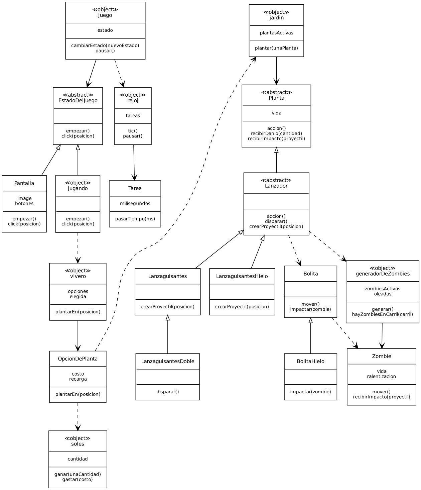

### Plantas Vz Zombies by Temu

* Alessio Deian Bergatti
* Gallini Guadalupe
* Masaragian Ignacio
* Torres Matias

Trabajo práctico integrador de Paradigmas de Programación (UTN FRBA, 2026), hecho en Wollok Game.

## Objetivo

Los zombies salen de la calle y avanzan por los 5 carriles del jardín hacia la casa. Plantá lanzaguisantes en el pasto para frenarlos, pero ojo: cada planta cuesta soles, y si un zombie tiene una planta adelante, se frena y se la come.

* **Ganás** si sobrevivís a las 3 oleadas.
* **Perdés** si un zombie llega a la casa.

## Oleadas

Cada oleada empieza con un cartel y trae más zombies que la anterior. Los zombies empiezan a salir cuando se va el cartel. Cuando eliminás a todos los de una oleada, tenés 5 segundos para plantar antes de la siguiente.

| Oleada | Zombies | Sale uno cada | Tipos |
|---|---|---|---|
| 1 | 6 | 6 segundos | Normales y rápidos |
| 2 | 8 | 5 segundos | Normales, rápidos y tanques |
| 3 | 12 | 2,5 segundos | Normales, rápidos y muchos tanques |

## Controles

| Acción | Control |
|---|---|
| Empezar a jugar | Click en **OK** |
| Elegir una planta | Teclas **1**, **2** y **3** (las de arriba de las letras) |
| Plantar | Click en una celda del pasto |
| Pausar | Tecla **P** o click en el botón de pausa (arriba a la derecha) |
| Volver a jugar | Click en **Reintentar** |

En la pausa todo se queda quieto. Desde ahí podés **Continuar** (o apretar **P** de nuevo) o **Reiniciar** la partida desde la oleada 1.

Reglas para plantar:

* Solo se puede plantar en el pasto: no en la casa, en la vereda ni en la calle.
* No se puede plantar encima de otra planta, pero sí donde hay un zombie.
* Cada planta cuesta soles. Si no te alcanzan, su tarjeta se ve gris y no se puede plantar.
* Si no se puede plantar, aparece un cartel arriba del jardín que dice por qué.
* Después de plantar, cada planta tarda un rato en recargarse. Los segundos que faltan se ven sobre su tarjeta en el panel.

## Soles

Los soles que tenés se ven arriba, al lado de las tarjetas.

* Arrancás cada partida con 150 soles.
* Ganás 25 soles cada 5 segundos y 25 más por cada zombie que eliminás.
* Se pueden juntar hasta 999.

## Plantas

Todas las plantas tienen 100 de vida. Cuando un zombie se las termina de comer, desaparecen y en esa celda se puede volver a plantar.

| Tecla | Planta | Qué hace | Costo | Recarga |
|---|---|---|---|---|
| 1 | Lanzaguisantes | Dispara un guisante (25 de daño) cada 2 segundos si hay zombies en su carril | 50 soles | 3 s |
| 2 | Lanzaguisantes de hielo | Igual que el anterior, pero el guisante además congela al zombie y lo hace caminar a la mitad de velocidad | 75 soles | 5 s |
| 3 | Lanzaguisantes doble | Dispara dos guisantes cada 3 segundos | 125 soles | 7 s |

## Zombies

| Zombie | Vida | Velocidad | Mordida |
|---|---|---|---|
| Normal | 100 | Un paso cada 2 segundos | 20 |
| Tanque | 400 | Un paso cada 3 segundos | 50 |
| Rápido | 50 | Un paso cada 1 segundo | 10 |

Mientras come, el zombie da una mordida en vez de cada paso. Si está congelado, también come a la mitad de velocidad.

## Cómo ejecutarlo

1. Abrí la carpeta del proyecto en VS Code con la extensión de Wollok instalada.
2. Abrí `mainJuego.wpgm` y ejecutá el programa `PlantasVsZombies` con el botón que aparece arriba de `program`.
3. El juego se abre en el navegador.

Desde una terminal con [wollok-ts-cli](https://github.com/uqbar-project/wollok-ts-cli):

```
wollok run mainJuego.PlantasVsZombies
```

Para correr los tests:

```
wollok test
```

## Diagrama de clases


